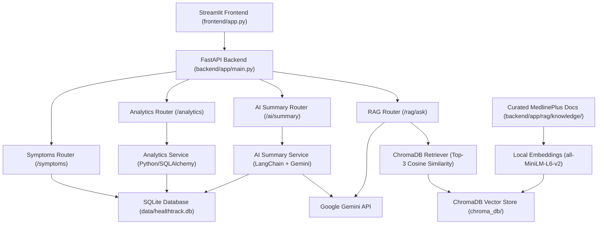

# HealthTrack AI — Intelligent Patient Symptom Monitoring & Consultation Assistant

**HealthTrack AI** is a full-stack symptom tracking, analytics, and health education application built with FastAPI, SQLAlchemy, SQLite, Streamlit, Plotly, ChromaDB, LangChain, and Gemini.

Patients often struggle to recall symptom timelines, severity fluctuations, and recurring patterns during brief clinical appointments. HealthTrack AI addresses this by allowing users to log structured symptom entries over time, visualize 30-day severity trends, generate concise non-diagnostic summaries for doctor visits, and ask general health education questions grounded in curated MedlinePlus reference documents.

> [!IMPORTANT]
> **Non-Diagnostic Disclaimer:** HealthTrack AI is an informational and documentation tool only. It is **not** a medical diagnosis, clinical decision-support, or treatment system, and it should never be used as a substitute for professional medical advice. Use synthetic patient IDs and records for demonstrations.

---

## Key Features

- **Patient Symptom Logging**: Record symptom descriptions with severity ratings (`1–10`) and ISO-8601 UTC timestamps via `POST /symptoms`.
- **Input Validation**: Rejects empty/whitespace-only `patient_id` or `symptom_description` values and enforces `1–10` severity bounds at both the API schema (`Pydantic v2`) and database (`SQLite CHECK` constraint) levels.
- **Patient-Specific Chronological History**: Retrieve a patient's logged entries sorted oldest-first (`GET /symptoms/{patient_id}`) in a clean Streamlit table.
- **30-Day Symptom Analytics**: Computes rolling 30-day UTC metrics in Python/SQLite (`GET /analytics/{patient_id}`), including total entries, average severity, highest severity, and daily average severity grouped by calendar date (omitting dates without entries).
- **Interactive Trend Visualization**: Displays an interactive Plotly line chart of daily average severity over the last 30 days in the Streamlit dashboard.
- **AI Doctor-Visit Summaries**: Generates structured, non-diagnostic visit summaries (`POST /ai/summary/{patient_id}`) using Gemini and LangChain, clearly separating **Recorded Facts** from **AI-Generated Observations**.
- **RAG Health Education Assistant**: Answers general health questions (`POST /rag/ask`) grounded in curated MedlinePlus documents stored in ChromaDB, returning clickable source citations and a safe fallback when questions fall outside the knowledge base.

---

## Technology Stack

| Category | Technologies |
| :--- | :--- |
| **Backend** | Python 3.11, FastAPI (`>=0.115,<1.0`), Uvicorn (`>=0.30,<1.0`), Pydantic v2 (`>=2.9,<3.0`), `python-dotenv` (`>=1.0,<2.0`) |
| **Frontend** | Streamlit (`>=1.40,<2.0`), `requests` (`>=2.32,<3.0`) |
| **Database** | SQLite, SQLAlchemy 2 (`>=2.0,<3.0`) |
| **AI / LLM** | Google Gemini API via `langchain` (`>=0.3,<2.0`) and `langchain-google-genai` (`>=2.0,<3.0`) |
| **RAG & Vector Database** | ChromaDB (`>=0.5,<2.0`), `langchain-chroma` (`>=0.2,<1.0`), `langchain-text-splitters` (`>=0.3,<2.0`) |
| **Embeddings** | Local Sentence Transformers (`sentence-transformers/all-MiniLM-L6-v2`) via `sentence-transformers` (`>=3.0,<6.0`) and `langchain-huggingface` (`>=0.1,<2.0`) |
| **Data & Visualization** | `pandas` (`>=2.2,<3.0`), `plotly` (`>=5.24,<7.0`) |
| **Testing** | `pytest` (`>=8.0,<9.0`), `httpx` (`>=0.27,<1.0`), FastAPI `TestClient`, Streamlit `AppTest` |

---

## System Architecture

HealthTrack AI separates **patient symptom data** (stored in SQLite) from **public health education knowledge** (stored in ChromaDB):

- The **Streamlit frontend** (`frontend/app.py`) communicates exclusively with the **FastAPI backend** over HTTP (`API_BASE_URL`, defaulting to `http://127.0.0.1:8000`).
- **Symptom logging & history** (`backend/app/routers/symptoms.py`) and **30-day analytics** (`backend/app/services/analytics_service.py`) read and write `SymptomLog` records in **SQLite** (`data/healthtrack.db`).
- **Doctor-visit summaries** (`backend/app/services/ai_service.py`) read a patient's chronological `SymptomLog` records from SQLite and pass them through a LangChain `ChatPromptTemplate` to **Gemini**.
- **RAG health education** (`backend/app/rag/`) ingests curated MedlinePlus Markdown files using local **Sentence Transformers** embeddings into **ChromaDB** (`chroma_db/`). On `POST /rag/ask`, the retriever fetches the top 3 relevant chunks above the cosine relevance threshold (`0.30`) and passes them to **Gemini** to produce a grounded, cited answer.



---

## Project Structure

```text
healthtrack-ai/
├── .env.example
├── .gitignore
├── README.md
├── requirements.txt
├── backend/
│   ├── __init__.py
│   ├── app/
│   │   ├── __init__.py
│   │   ├── database.py
│   │   ├── main.py
│   │   ├── models.py
│   │   ├── schemas.py
│   │   ├── rag/
│   │   │   ├── __init__.py
│   │   │   ├── chains.py
│   │   │   ├── embeddings.py
│   │   │   ├── ingest.py
│   │   │   ├── retriever.py
│   │   │   └── knowledge/
│   │   │       ├── common_cold.md
│   │   │       ├── dehydration.md
│   │   │       ├── fever.md
│   │   │       └── headache.md
│   │   ├── routers/
│   │   │   ├── __init__.py
│   │   │   ├── ai.py
│   │   │   ├── analytics.py
│   │   │   ├── rag.py
│   │   │   └── symptoms.py
│   │   └── services/
│   │       ├── __init__.py
│   │       ├── ai_service.py
│   │       └── analytics_service.py
│   └── tests/
│       ├── __init__.py
│       ├── test_ai.py
│       ├── test_analytics.py
│       ├── test_rag.py
│       └── test_symptoms.py
├── chroma_db/
├── data/
└── frontend/
    ├── __init__.py
    └── app.py
```

---

## Installation and Setup (macOS / Linux)

1. **Clone the repository**
   ```bash
   git clone https://github.com/ishaankonathala/healthtrack-ai.git
   cd healthtrack-ai
   ```

2. **Create and activate a Python 3.11 virtual environment**
   ```bash
   python3 -m venv .venv
   source .venv/bin/activate
   ```

3. **Install dependencies**
   ```bash
   pip install -r requirements.txt
   ```

4. **Configure environment variables**
   ```bash
   cp .env.example .env
   ```
   Edit `.env` and set `GEMINI_API_KEY` to your Gemini API key.

5. **Ingest the curated health education knowledge base into ChromaDB**
   ```bash
   .venv/bin/python -m backend.app.rag.ingest
   ```

6. **Start the FastAPI backend**
   ```bash
   .venv/bin/uvicorn backend.app.main:app --reload
   ```

7. **Start the Streamlit frontend (in a separate terminal)**
   ```bash
   .venv/bin/streamlit run frontend/app.py
   ```

8. **Access the application**
   - **Streamlit Dashboard:** `http://localhost:8501`
   - **FastAPI Interactive Swagger Docs:** `http://127.0.0.1:8000/docs`

---

## Environment Variables

All environment variables read by the application are listed below (see [.env.example](.env.example) for placeholder values):

| Variable | Required | Default | Purpose |
| :--- | :--- | :--- | :--- |
| `GEMINI_API_KEY` | Yes (for `/ai/summary` and `/rag/ask`) | None | Google Gemini API key loaded via `python-dotenv` |
| `GEMINI_MODEL` | No | `gemini-3.8-flash` | Gemini model name used by LangChain |
| `DATABASE_URL` | No | `sqlite:///./data/healthtrack.db` | SQLAlchemy database connection string |
| `CHROMA_PERSIST_DIR` | No | `./chroma_db` | Directory for persistent ChromaDB storage |
| `API_BASE_URL` | No | `http://127.0.0.1:8000` | Default backend URL used by the Streamlit frontend |

---

## API Documentation

Interactive OpenAPI / Swagger documentation is available at `http://127.0.0.1:8000/docs` when the FastAPI server is running.

| Method | Path | Purpose | Request / Path Inputs | Key Responses & Error Handling |
| :--- | :--- | :--- | :--- | :--- |
| `GET` | `/` | Service identification | None | `200 OK` returning `{"message": "HealthTrack AI API"}` |
| `GET` | `/health` | Health check | None | `200 OK` returning `{"status": "ok"}` |
| `POST` | `/symptoms` | Log a symptom entry | JSON body: `patient_id` (non-empty string, max 100 chars), `symptom_description` (non-empty string, max 2,000 chars), `severity` (int `1–10`), optional `timestamp` (ISO-8601 `datetime`) | `201 Created` with `SymptomResponse`; `422` on empty/whitespace text, exceeding max length, or out-of-range severity |
| `GET` | `/symptoms/{patient_id}` | Retrieve patient history | Path: `patient_id` (non-empty string) | `200 OK` with list of `SymptomResponse` sorted oldest-first (`timestamp ASC, id ASC`); `422` on blank `patient_id` |
| `GET` | `/analytics/{patient_id}` | 30-day symptom analytics | Path: `patient_id` (non-empty string) | `200 OK` with `AnalyticsResponse` (`total_entries`, `average_severity`, `highest_severity`, `daily_trend`); `422` on blank `patient_id` |
| `POST` | `/ai/summary/{patient_id}` | Generate doctor-visit summary | Path: `patient_id` (non-empty string) | `200 OK` with `AISummaryResponse` (`summary`, `entry_count`, `model`, `disclaimer`); `404` if no records exist, `503` if `GEMINI_API_KEY` is missing, `502` on provider failure, `422` on blank `patient_id` |
| `POST` | `/rag/ask` | Ask health education assistant | JSON body: `question` (non-empty string, max 1,000 chars) | `200 OK` with `RAGAskResponse` (`question`, `answer`, `sources`); `422` on blank `question` or exceeding max length, `429` on Gemini quota limit, `503` on auth/config error, `504` on timeout, `502` on provider failure |

---

## RAG Implementation

- **Curated Knowledge Base (`backend/app/rag/knowledge/`)**: Four concise educational Markdown documents derived from MedlinePlus topics, each containing `title` and `url` frontmatter metadata:
  - [MedlinePlus - Headache](https://medlineplus.gov/headache.html) (`headache.md`)
  - [MedlinePlus - Fever](https://medlineplus.gov/fever.html) (`fever.md`)
  - [MedlinePlus - Dehydration](https://medlineplus.gov/dehydration.html) (`dehydration.md`)
  - [MedlinePlus - Common Cold](https://medlineplus.gov/commoncold.html) (`common_cold.md`)
- **Chunking & Persistence (`backend/app/rag/ingest.py`)**: Uses `RecursiveCharacterTextSplitter` with `chunk_size=500` and `chunk_overlap=75`. Each chunk is assigned a deterministic SHA-256 ID (`source_file:chunk_index:text`) so re-running ingestion skips existing chunks without creating duplicates.
- **Local Embeddings (`backend/app/rag/embeddings.py`)**: Uses `sentence-transformers/all-MiniLM-L6-v2` via `HuggingFaceEmbeddings` with normalized embeddings (`normalize_embeddings=True`) and `local_files_only=True` fallback once cached.
- **Retrieval (`backend/app/rag/retriever.py`)**: Queries the persistent `health_education` ChromaDB collection (`hnsw:space: cosine`) for the top 3 chunks (`top_k=3`) and filters out results below `score_threshold=0.30`.
- **Grounded Generation & Citations (`backend/app/rag/chains.py`)**: Groups retrieved chunks by `(source_title, source_url)` into `[Source 1]`, `[Source 2]`, etc., matching the `sources` list returned to the UI. If no chunks pass the relevance threshold, `INSUFFICIENT_INFO_ANSWER` is returned without calling Gemini.

**Ingestion command:**
```bash
.venv/bin/python -m backend.app.rag.ingest
```

---

## AI Usage and Design Decisions

- **Deterministic Python/SQLAlchemy for Analytics**: Counts, averages, maximums, and daily groupings are computed deterministically in `analytics_service.py` rather than by an LLM, preventing hallucinated statistics.
- **Gemini + LangChain for Natural Language Tasks**: Gemini is used strictly for synthesizing readable doctor-visit summaries from logged SQLite records and answering health education questions grounded in retrieved MedlinePlus chunks.
- **Local Embeddings + ChromaDB**: Running `all-MiniLM-L6-v2` locally avoids consuming Gemini API quota during document indexing and similarity search.
- **Not an Autonomous Agent**: The application uses fixed, predictable LangChain LCEL chains (`prompt | llm | StrOutputParser()`) with explicit safety instructions—no autonomous agents, tool-calling loops, or self-directed workflows.

---

## Data Privacy and Safety

- API keys are loaded from `.env` via `python-dotenv` and are never hardcoded in source files.
- `.env` is excluded from Git via `.gitignore` (while `.env.example` is explicitly allowed).
- Patient symptom records are stored locally in SQLite (`data/healthtrack.db`) and are **never** indexed into ChromaDB.
- Symptom records remain local in SQLite and are **not** automatically sent to Gemini; they are only transmitted to the Google Gemini API when the AI doctor-visit summary endpoint (`POST /ai/summary/{patient_id}`) is explicitly invoked, at which point the patient's symptom history and associated `patient_id` are sent to Gemini for processing.
- ChromaDB stores only the curated public MedlinePlus educational documents.
- Both AI endpoints include explicit non-diagnostic guardrails prohibiting disease diagnosis, medication prescriptions, or treatment recommendations.
- **Important:** Only synthetic patient data should be used. Never enter, store, or transmit real patient medical information in this assessment prototype.

### Authentication and Authorization

- This application currently has **no user authentication or patient-level authorization**.
- The symptom history (`GET /symptoms/{patient_id}`), analytics (`GET /analytics/{patient_id}`), and AI summary (`POST /ai/summary/{patient_id}`) endpoints are not protected by user authentication, meaning any client with access to the API can read or generate summaries for any `patient_id`.
- Consequently, this prototype is **not suitable for production use or real patient data** without implementing proper authentication, authorization, and privacy controls.

---

## Testing

The backend test suite in `backend/tests/` uses isolated temporary SQLite databases, temporary ChromaDB directories, and mocked Gemini/LangChain runnables so no paid API calls are made:

```bash
.venv/bin/pytest -v backend/tests
```

Test modules included in the repository (**35 tests total**):
- `backend/tests/test_symptoms.py` — symptom creation, validation boundaries (including 2,000-character max length), chronological retrieval, and patient isolation (15 tests).
- `backend/tests/test_analytics.py` — 30-day rolling window calculations, daily grouping, missing-date omission, and empty history (5 tests).
- `backend/tests/test_ai.py` — mocked Gemini summary generation, empty history (`404`), missing API key (`503`), and patient isolation (4 tests).
- `backend/tests/test_rag.py` — ingestion, duplicate prevention, top-3 retrieval with metadata, citation grouping, empty question and 1,000-character max-length validation (`422`), out-of-scope fallback, and mocked grounded answers (7 tests).
- `backend/tests/test_config.py` — `.env` loading, OS environment variable precedence, default values, and subprocess-isolated circular import checks (4 tests).

---

## Limitations and Future Improvements

**Current Limitations**
- No user authentication or role-based access control; any client can query by `patient_id`.
- Single-node SQLite and local ChromaDB storage suited for local/prototype use.
- The RAG knowledge base currently covers four MedlinePlus topics (headache, fever, dehydration, common cold).

**Possible Future Improvements**
- Add user authentication and per-user authorization.
- Expand the curated MedlinePlus knowledge base with additional clinical education topics.
- Add exportable PDF/Markdown doctor-visit reports and containerization (`Dockerfile` / `docker-compose.yml`).

---

## Suggested Demo Flow

1. **Log a symptom**: Enter a synthetic Patient ID (e.g., `patient-001`), add a symptom description and severity (`1–10`), and click **Submit Symptom**.
2. **View patient history**: Verify the entry appears in the **Patient History** table sorted oldest-first.
3. **Explore 30-day analytics**: Log a few more symptoms and inspect **Total Entries**, **Average Severity**, **Highest Severity**, and the interactive **Plotly** daily trend chart.
4. **Generate an AI doctor-visit summary**: Click **Generate Summary** under **AI Doctor-Visit Summary** to view a non-diagnostic summary of the patient's recorded facts and patterns.
5. **Ask a health education question**: In **AI Health Education Assistant**, ask *"What are common signs of dehydration?"* and inspect the grounded answer and clickable MedlinePlus source links.
6. **Demonstrate the safe fallback**: Ask an out-of-scope question (e.g., *"What is the capital of France?"*) to show the neutral insufficient-information response without calling Gemini.
