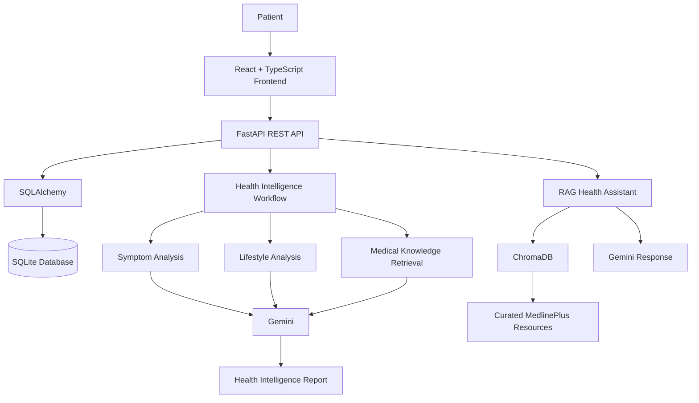

# HealthTrack AI — Patient Symptom Tracker

<p align="center">

**Understand your health. Track your symptoms. Make better-informed decisions.**

A full-stack AI-powered health tracking application that helps patients record symptoms, monitor health patterns, and prepare meaningful summaries for healthcare consultations.

</p>

<p align="center">


</p>

---

## Overview

HealthTrack AI is a full-stack patient symptom tracking platform developed around a simple idea: **patients should be able to understand and communicate their health experiences more effectively.**

Users can record symptoms, assign severity levels, track mood and sleep, and explore changes in their health patterns through interactive dashboards. The application also incorporates AI-powered health education and a bounded Health Intelligence workflow to turn recorded observations into structured insights.

Rather than relying on a basic symptom-entry form, HealthTrack combines a modern web interface, a structured backend, data visualisation, retrieval-augmented generation (RAG), and agent-based AI workflows.

> **Project objective:** Build a reliable, user-friendly symptom tracking application that satisfies the core patient symptom logging requirements while demonstrating thoughtful software architecture and practical AI integration.

## Features

### 1. Patient Symptom Tracking
- Record symptoms with a patient ID, description, severity, and timestamp.
- Validate symptom descriptions and severity values.
- View symptom history in chronological order.
- Edit and delete existing symptom entries.
- Filter and explore previously recorded symptoms.

### 2. Health Dashboard and Analytics
- Monitor symptom history through an interactive dashboard.
- Explore severity patterns over time.
- View 30-day and advanced health analytics.
- Record daily mood and sleep check-ins.
- Visualise health-related trends to make historical information easier to understand.

### 3. Interactive 3D Anatomy Viewer
- Explore an interactive 3D human anatomy interface.
- Uses Three.js to render anatomy assets.
- Provides a visual way to explore the human body alongside health tracking.

### 4. AI Health Intelligence
- Uses a bounded LangGraph workflow to organise health-related analysis.
- Combines deterministic symptom and lifestyle analysis with optional medical knowledge retrieval.
- Uses Gemini to generate a structured explanation of the available observations.
- Produces an understandable health intelligence report.

The workflow is designed to provide informational insights, not medical diagnoses.

### 5. RAG-Powered Health Education Assistant
- Uses Retrieval-Augmented Generation (RAG).
- Retrieves relevant information from curated MedlinePlus health resources.
- Uses ChromaDB for vector storage and similarity search.
- Uses Sentence Transformers for local text embeddings.
- Provides educational responses with supporting references.
- Includes a fallback when relevant information is unavailable.

### 6. Doctor Visit Summary
- Generates an AI-assisted summary of recorded symptoms.
- Helps organise symptom history into information that can be discussed during a healthcare consultation.
- Runs only when explicitly requested.

---

## Technology Stack

| Layer | Technologies |
|---|---|
| Frontend | React, TypeScript, Vite |
| UI and Visualisation | Three.js, interactive charts |
| Backend | Python, FastAPI |
| API Validation | Pydantic v2 |
| Database | SQLite, SQLAlchemy 2 |
| AI Model | Google Gemini |
| AI Orchestration | LangChain, LangGraph |
| RAG | ChromaDB, Sentence Transformers |
| Embedding Model | all-MiniLM-L6-v2 |
| Testing | Pytest, HTTPX |
| Development | Git, GitHub, npm, Python virtual environments |

---

## Architecture

HealthTrack AI follows a separated frontend and backend architecture.



### Architectural decisions

- **Frontend/backend separation:** React handles the user interface, while FastAPI manages application logic and data operations.
- **Structured persistence:** SQLAlchemy provides database interaction and keeps database operations separate from API routes.
- **Input validation:** Pydantic validates incoming API data before processing.
- **Bounded AI workflow:** LangGraph organises a controlled sequence of analysis steps instead of allowing unrestricted autonomous agent behaviour.
- **Grounded health education:** The RAG assistant retrieves information from a curated knowledge base before generating educational responses.
- **Local development:** SQLite and local embedding models keep the application practical to run without requiring a managed database or paid vector database.

---

## Project Structure

```text
healthtrack-ai/
│
├── backend/
│   ├── app/
│   │   ├── api/
│   │   ├── models/
│   │   ├── schemas/
│   │   ├── services/
│   │   ├── rag/
│   │   ├── health_intelligence/
│   │   ├── config.py
│   │   ├── database.py
│   │   └── main.py
│   │
│   └── tests/
│
├── frontend/
│   └── web/
│       ├── public/
│       ├── src/
│       │   ├── components/
│       │   ├── pages/
│       │   ├── services/
│       │   └── ...
│       ├── package.json
│       └── vite.config.ts
│
├── requirements.txt
├── requirements-dev.txt
├── .env.example
├── .gitignore
└── README.md
```

---

## Getting Started

### Prerequisites

Install the following:

- Python 3.11 or later
- Node.js 20 or later
- npm
- Git

### 1. Clone the repository

```bash
git clone https://github.com/ishaankonathala/healthtrack-ai.git
cd healthtrack-ai
```

### 2. Create and activate a Python virtual environment

macOS / Linux:

```bash
python3.11 -m venv .venv
source .venv/bin/activate
```

### 3. Install backend dependencies

```bash
pip install -r requirements-dev.txt
```

### 4. Configure environment variables

Create your local environment file:

```bash
cp .env.example .env
```

Add your Google Gemini API key and configure the other values documented in `.env.example`.

```env
GEMINI_API_KEY=your_gemini_api_key
```

Never commit your actual `.env` file or expose API keys in source code.

### 5. Start the backend

From the project root:

```bash
python -m uvicorn backend.app.main:app --reload
```

Backend:

`http://127.0.0.1:8000`

Interactive API documentation:

`http://127.0.0.1:8000/docs`

### 6. Install frontend dependencies

Open another terminal:

```bash
cd frontend/web
npm install
```

### 7. Start the frontend

```bash
npm run dev
```

Open the local URL displayed by Vite, normally:

`http://localhost:5173`

**Keep both frontend and backend terminals running while using the application.**

---

## Running Tests

Activate the Python virtual environment from the project root:

```bash
source .venv/bin/activate
```

Run backend tests:

```bash
python -m pytest backend/tests -q
```

Build the frontend for production:

```bash
cd frontend/web
npm run build
```

The backend test suite has passed **133 tests** during development. The React production build has also completed successfully.

---

## Assignment Requirement Coverage

The project was developed around the requirements of the Patient Symptom Tracker brief.

| Assignment requirement | Implementation |
|---|---|
| Patient symptom data model | Structured database model |
| Patient ID, description, severity and timestamp | Implemented |
| Store and retrieve multiple symptom logs | Database persistence |
| Validate non-empty symptom descriptions | Backend validation |
| Severity between 1 and 10 | Backend validation |
| Submit new symptom entries through an API | FastAPI endpoints |
| Retrieve logs for a specific patient | Patient-based retrieval |
| Sort symptom logs by timestamp | Chronological ordering |
| Frontend symptom entry form | React interface |
| Display symptom history | Interactive dashboard and history |
| Handle submission errors | Frontend/backend error handling |
| Visualise symptom severity trends | Analytics and charts |

### Additional functionality

Beyond the core requirements, HealthTrack includes:

- Mood and sleep tracking.
- Advanced analytics and 30-day trends.
- Interactive 3D anatomy visualisation.
- AI-generated doctor visit summaries.
- LangGraph-based Health Intelligence.
- RAG-powered health education assistant.

---

## AI Implementation

### Health Intelligence — LangGraph

The Health Intelligence feature uses a controlled workflow to organise the analysis of available health observations.

Its design includes:

1. **Symptom Analysis:** Examines recorded symptom information.
2. **Lifestyle Analysis:** Considers available lifestyle observations such as mood and sleep.
3. **Medical Knowledge:** Retrieves relevant medical information where applicable.
4. **AI Explanation:** Uses Gemini to generate a structured explanation.
5. **Report Generation:** Produces an understandable health intelligence report.

The workflow is deliberately bounded. It does not use unrestricted autonomous tool calling, indefinite ReAct loops, or AI-driven modification of patient records.

### RAG — Health Education Assistant

The RAG pipeline follows this process:

```text
User Question
     |
     v
Text Embedding
     |
     v
ChromaDB Similarity Search
     |
     v
Relevant Health References
     |
     v
Gemini
     |
     v
Educational Response with References
```

The knowledge base uses curated MedlinePlus resources covering topics such as:

- Headache
- Fever
- Dehydration
- Common cold

The embedding model is `all-MiniLM-L6-v2`, which runs locally through Sentence Transformers.

---

## AI Usage

AI tools were used as development assistants during the creation of HealthTrack AI. They supported implementation and problem-solving, but the final application was assembled, tested, reviewed, and run by the developer.

### Tools and how they were used

Tool	How it was used
ChatGPT	Used as a technical reference for understanding concepts, discussing architectural choices and resolving specific development questions.
OpenAI Codex	Used to assist with code exploration, implementation tasks and debugging. Suggested changes were reviewed and tested before being incorporated.
Google Gemini	Integrated into the application to power Health Intelligence reports, AI-generated explanations and the RAG-based health education assistant.

### How AI-assisted work was verified

AI-generated suggestions were not treated as automatically correct. Development decisions and generated code were checked through:

- Reviewing and adapting generated code to the existing project structure.
- Checking API validation and error-handling behaviour.
- Running backend tests using Pytest.
- Building the React frontend using Vite.
- Checking that backend and frontend functionality worked together.
- Reviewing AI workflow boundaries and data handling.
- Checking RAG retrieval and response behaviour.
- Updating documentation to reflect the implemented architecture.

**Important distinction:** Gemini is also an application dependency. Its runtime use for generating health-related responses is separate from the use of AI assistants during software development.

---

## Privacy, Security and Limitations

HealthTrack AI is a prototype built for demonstration and educational purposes.

- The application uses synthetic demonstration data.
- It does not implement user authentication or patient-level authorisation.
- It is not designed to store real patient health information or protected health information (PHI).
- Patient symptom records are not indexed into the ChromaDB knowledge base.
- The doctor visit summary sends the relevant patient identifier and symptom history to Gemini only when explicitly requested.
- Health Intelligence uses bounded aggregate observations rather than patient identifiers or unrestricted free-text records.
- The RAG assistant sends the user's question and retrieved curated references to Gemini to generate an educational response.
- AI-generated outputs may be incomplete or inaccurate and must not replace professional medical advice.

The project does not connect to external hospital systems, electronic health records, or medical devices.

---

## Design Decisions and Trade-offs

| Decision | Reason |
|---|---|
| React + FastAPI | Clear separation of frontend and backend responsibilities |
| SQLite | Lightweight persistence for local development |
| SQLAlchemy | Structured database access and maintainable data operations |
| Pydantic | Consistent request validation and data schemas |
| LangGraph | Explicit control over the AI analysis workflow |
| ChromaDB | Local vector storage for retrieval |
| Sentence Transformers | Local embedding generation |
| Gemini | Natural-language explanations and educational responses |
| Pytest | Repeatable automated backend testing |

The application prioritises a maintainable architecture, predictable data handling, and controlled AI integration over unnecessary infrastructure.

---

## Future Improvements

- Add authentication and patient-level access control.
- Introduce PostgreSQL for multi-user environments.
- Add database migration tooling.
- Improve analytics and personalised trend comparisons.
- Expand the curated medical knowledge base.
- Add clinician-facing dashboards and secure health report sharing.
- Improve automated frontend and end-to-end test coverage.

---

## Demo Walkthrough

A suggested demonstration flow:

1. Launch the FastAPI backend and React frontend.
2. Open the patient dashboard.
3. Add a new symptom and select its severity.
4. Show the saved symptom entry and chronological history.
5. Demonstrate editing, deleting, and filtering symptom logs.
6. Record mood and sleep information.
7. Explore the analytics dashboard and severity trends.
8. Demonstrate the 3D anatomy viewer.
9. Run the Health Intelligence workflow.
10. Ask the RAG assistant a health education question and show its references.
11. Briefly walk through the backend data model, validation, API routes, and AI workflow implementation.

---

## Author

**Ishaan Konathala**

B.Tech — Computer Science (Artificial Intelligence and Machine Learning)

REVA University | 2023–2027

GitHub: [@ishaankonathala](https://github.com/ishaankonathala)

---

<p align="center">

**HealthTrack AI**

*Turning symptom records into clearer health conversations.*

Built with Python, FastAPI, React, and AI.

</p>
