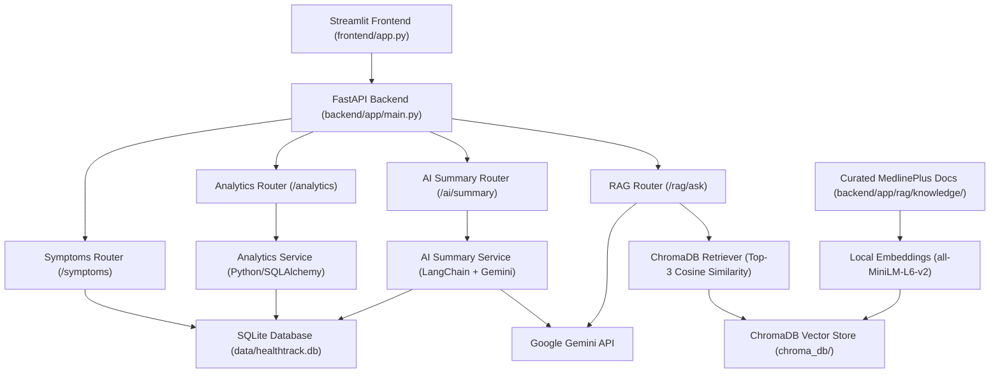

# HealthTrack AI — Intelligent Patient Symptom Monitoring & Consultation Assistant

**HealthTrack AI** is a full-stack symptom tracking, analytics, and health education application built with FastAPI, SQLAlchemy, SQLite, Streamlit, Plotly, ChromaDB, LangChain, and Gemini.

Patients often struggle to recall symptom timelines, severity fluctuations, and recurring patterns during brief clinical appointments. HealthTrack AI addresses this by allowing users to log structured symptom entries over time, visualize 30-day severity trends, generate concise non-diagnostic summaries for doctor visits, and ask general health education questions grounded in curated MedlinePlus reference documents.

> [!IMPORTANT]
> **Non-Diagnostic Disclaimer:** HealthTrack AI is an informational and documentation tool only. It is **not** a medical diagnosis, clinical decision-support, or treatment system, and it should never be used as a substitute for professional medical advice. Use synthetic patient IDs and records for demonstrations.

---

## Key Features

- **Patient Symptom Logging**: Record symptom descriptions with severity ratings (`1–10`) and ISO-8601 UTC timestamps via `POST /symptoms`.
- **Categorized Symptom History**: Add a symptom category, optional patient notes, and patient-reported possible triggers; edit or delete patient-owned entries and combine category, severity, and UTC date filters.
- **Daily Mood & Sleep Check-ins**: Store one combined mood and sleep record per patient per UTC calendar date, with optional labels and notes. Duplicate dates return `409 Conflict`; edit the existing row instead.
- **Input Validation**: Rejects empty/whitespace-only `patient_id` or `symptom_description` values and enforces `1–10` severity bounds at both the API schema (`Pydantic v2`) and database (`SQLite CHECK` constraint) levels.
- **Patient-Specific Chronological History**: Retrieve a patient's logged entries sorted oldest-first (`GET /symptoms/{patient_id}`) in a clean Streamlit table.
- **30-Day Symptom Analytics**: Computes rolling 30-day UTC metrics in Python/SQLite (`GET /analytics/{patient_id}`), including total entries, average severity, highest severity, and daily average severity grouped by calendar date (omitting dates without entries).
- **Advanced Health Analytics**: `GET /analytics/{patient_id}/advanced` provides date-bounded daily/weekly/monthly trends, category counts and severity, transparent recurrence patterns, and date-aligned mood/sleep comparisons.
- **Interactive Trend Visualization**: Displays an interactive Plotly line chart of daily average severity over the last 30 days in the Streamlit dashboard.
- **AI Doctor-Visit Summaries**: Generates structured, non-diagnostic visit summaries (`POST /ai/summary/{patient_id}`) using Gemini and LangChain, clearly separating **Recorded Facts** from **AI-Generated Observations**.
- **Explicit Health Intelligence Reports**: A fixed LangGraph workflow combines bounded deterministic symptom and mood/sleep evidence with a constrained Gemini explanation step (`POST /ai/health-intelligence/{patient_id}`).
- **RAG Health Education Assistant**: Answers general health questions (`POST /rag/ask`) grounded in curated MedlinePlus documents stored in ChromaDB, returning clickable source citations and a safe fallback when questions fall outside the knowledge base.

---

## Technology Stack

| Category | Technologies |
| :--- | :--- |
| **Backend** | Python 3.11, FastAPI (`>=0.115,<1.0`), Uvicorn (`>=0.30,<1.0`), Pydantic v2 (`>=2.9,<3.0`), `python-dotenv` (`>=1.0,<2.0`) |
| **Frontend** | Streamlit (`>=1.40,<2.0`), `requests` (`>=2.32,<3.0`) |
| **Database** | SQLite, SQLAlchemy 2 (`>=2.0,<3.0`) |
| **AI / LLM** | Google Gemini API via `langchain` (`>=0.3,<2.0`) and `langchain-google-genai` (`>=2.0,<3.0`) |
| **RAG & Vector Database** | ChromaDB (`>=0.5,<2.0`), `langchain-chroma` (`>=0.2,<1.0`), `langchain-text-splitters` (`>=0.3,<2.0`) |
| **Embeddings** | Local Sentence Transformers (`sentence-transformers/all-MiniLM-L6-v2`) via `sentence-transformers` (`>=3.0,<6.0`) and `langchain-huggingface` (`>=0.1,<2.0`) |
| **Data & Visualization** | `pandas` (`>=2.2,<3.0`), `plotly` (`>=5.24,<7.0`) |
| **Testing** | `pytest` (`>=8.0,<9.0`), `httpx` (`>=0.27,<1.0`), FastAPI `TestClient`, Streamlit `AppTest` |

---

## System Architecture

HealthTrack AI separates **patient symptom data** (stored in SQLite) from **public health education knowledge** (stored in ChromaDB):

- The **Streamlit frontend** (`frontend/app.py`) communicates exclusively with the **FastAPI backend** over HTTP (`API_BASE_URL`, defaulting to `http://127.0.0.1:8000`).
- **Symptom logging & history** (`backend/app/routers/symptoms.py`) and **30-day analytics** (`backend/app/services/analytics_service.py`) read and write `SymptomLog` records in **SQLite** (`data/healthtrack.db`).
- **Doctor-visit summaries** (`backend/app/services/ai_service.py`) read a patient's chronological `SymptomLog` records from SQLite and pass them through a LangChain `ChatPromptTemplate` to **Gemini**.
- **RAG health education** (`backend/app/rag/`) ingests curated MedlinePlus Markdown files using local **Sentence Transformers** embeddings into **ChromaDB** (`chroma_db/`). On `POST /rag/ask`, the retriever fetches the top 3 relevant chunks above the cosine relevance threshold (`0.30`) and passes them to **Gemini** to produce a grounded, cited answer.



---

## Project Structure

```text
healthtrack-ai/
├── .env.example
├── .gitignore
├── README.md
├── requirements.txt
├── backend/
│   ├── __init__.py
│   ├── app/
│   │   ├── __init__.py
│   │   ├── database.py
│   │   ├── main.py
│   │   ├── models.py
│   │   ├── schemas.py
│   │   ├── rag/
│   │   │   ├── __init__.py
│   │   │   ├── chains.py
│   │   │   ├── embeddings.py
│   │   │   ├── ingest.py
│   │   │   ├── retriever.py
│   │   │   └── knowledge/
│   │   │       ├── common_cold.md
│   │   │       ├── dehydration.md
│   │   │       ├── fever.md
│   │   │       └── headache.md
│   │   ├── routers/
│   │   │   ├── __init__.py
│   │   │   ├── ai.py
│   │   │   ├── analytics.py
│   │   │   ├── rag.py
│   │   │   └── symptoms.py
│   │   └── services/
│   │       ├── __init__.py
│   │       ├── ai_service.py
│   │       └── analytics_service.py
│   └── tests/
│       ├── __init__.py
│       ├── test_ai.py
│       ├── test_analytics.py
│       ├── test_rag.py
│       └── test_symptoms.py
├── chroma_db/
├── data/
└── frontend/
    ├── __init__.py
    └── app.py
```

---

## Installation and Setup (macOS / Linux)

1. **Clone the repository**
   ```bash
   git clone https://github.com/ishaankonathala/healthtrack-ai.git
   cd healthtrack-ai
   ```

2. **Create and activate a Python 3.11 virtual environment**
   ```bash
   python3 -m venv .venv
   source .venv/bin/activate
   ```

3. **Install dependencies**
   ```bash
   pip install -r requirements.txt
   ```

4. **Configure environment variables**
   ```bash
   cp .env.example .env
   ```
   Edit `.env` and set `GEMINI_API_KEY` to your Gemini API key.

5. **Ingest the curated health education knowledge base into ChromaDB**
   ```bash
   .venv/bin/python -m backend.app.rag.ingest
   ```

6. **Start the FastAPI backend**
   ```bash
   .venv/bin/uvicorn backend.app.main:app --reload
   ```

7. **Start the Streamlit frontend (in a separate terminal)**
   ```bash
   .venv/bin/streamlit run frontend/app.py
   ```

8. **Access the application**
   - **Streamlit Dashboard:** `http://localhost:8501`
   - **FastAPI Interactive Swagger Docs:** `http://127.0.0.1:8000/docs`

---

## Environment Variables

All environment variables read by the application are listed below (see [.env.example](.env.example) for placeholder values):

| Variable | Required | Default | Purpose |
| :--- | :--- | :--- | :--- |
| `GEMINI_API_KEY` | Yes (for `/ai/summary`, `/rag/ask`, and available AI text in Health Intelligence) | None | Google Gemini API key loaded via `python-dotenv` |
| `GEMINI_MODEL` | No | `gemini-3.8-flash` | Gemini model name used by LangChain |
| `DATABASE_URL` | No | `sqlite:///./data/healthtrack.db` | SQLAlchemy database connection string |
| `CHROMA_PERSIST_DIR` | No | `./chroma_db` | Directory for persistent ChromaDB storage |
| `API_BASE_URL` | No | `http://127.0.0.1:8000` | Default backend URL used by the Streamlit frontend |

---

## API Documentation

Interactive OpenAPI / Swagger documentation is available at `http://127.0.0.1:8000/docs` when the FastAPI server is running.

| Method | Path | Purpose | Request / Path Inputs | Key Responses & Error Handling |
| :--- | :--- | :--- | :--- | :--- |
| `GET` | `/` | Service identification | None | `200 OK` returning `{"message": "HealthTrack AI API"}` |
| `GET` | `/health` | Health check | None | `200 OK` returning `{"status": "ok"}` |
| `POST` | `/symptoms` | Log a symptom entry | Existing fields plus optional `category`, `notes`, and `possible_triggers`; category defaults to `General / Other` for older clients | `201 Created` with `SymptomResponse`; `422` on invalid category, text, or severity |
| `GET` | `/symptoms/{patient_id}` | Retrieve patient history | Path: `patient_id`; optional combined `category`, `min_severity`, `max_severity`, `date_from`, `date_to` query filters; use `category=uncategorized` for legacy rows | `200 OK` with oldest-first `SymptomResponse[]`; `422` for invalid or conflicting filters |
| `PATCH` | `/symptoms/{patient_id}/{record_id}` | Edit a patient-owned symptom | Path: `patient_id`, `record_id`; JSON with one or more symptom fields | `200 OK` with updated record; `404` if missing or owned by another patient; `422` for invalid or empty updates |
| `DELETE` | `/symptoms/{patient_id}/{record_id}` | Delete a patient-owned symptom | Path: `patient_id`, `record_id` | `204 No Content`; `404` if missing or owned by another patient |
| `POST` | `/mood-sleep` | Create a daily mood and sleep check-in | JSON: `patient_id`, `record_date` (optional UTC date), `mood_rating` (`1–5`), optional `mood_label` / `mood_notes`, `sleep_duration_hours` (`0–24`), `sleep_quality` (`1–5`), optional `sleep_notes` | `201 Created`; `409` if a record already exists for that patient/date; `422` for invalid fields |
| `GET` | `/mood-sleep/{patient_id}` | Retrieve daily mood and sleep history | Path: `patient_id` | `200 OK` with `MoodSleepResponse[]`, sorted by date ascending; `422` for blank `patient_id` |
| `PATCH` | `/mood-sleep/{patient_id}/{record_id}` | Partially update a patient's daily record | Path: `patient_id`, `record_id`; JSON with one or more supported fields | `200 OK` with updated record; `404` if absent or owned by another patient; `409` if date conflicts; `422` for invalid/empty updates |
| `DELETE` | `/mood-sleep/{patient_id}/{record_id}` | Delete a patient's daily record | Path: `patient_id`, `record_id` | `204 No Content`; `404` if absent or owned by another patient |
| `GET` | `/analytics/{patient_id}` | 30-day symptom analytics | Path: `patient_id` (non-empty string) | `200 OK` with `AnalyticsResponse` (`total_entries`, `average_severity`, `highest_severity`, `daily_trend`); `422` on blank `patient_id` |
| `GET` | `/analytics/{patient_id}/advanced` | Date-bounded deterministic analytics | Optional query: `date_from`, `date_to` (ISO dates, inclusive UTC calendar days), `interval` (`daily`, `weekly`, `monthly`); defaults to the latest 30 UTC dates and `daily` | `200 OK` with summary metrics, buckets, category frequency/severity, recurring patterns, and mood/sleep comparisons; `422` for invalid interval/range |
| `POST` | `/ai/summary/{patient_id}` | Generate doctor-visit summary | Path: `patient_id` (non-empty string) | `200 OK` with `AISummaryResponse` (`summary`, `entry_count`, `model`, `disclaimer`); `404` if no records exist, `503` if `GEMINI_API_KEY` is missing, `502` on provider failure, `422` on blank `patient_id` |
| `POST` | `/ai/health-intelligence/{patient_id}` | Explicitly run bounded health analysis and optional education retrieval | Path: `patient_id` (1–100 chars); JSON: `date_from`, `date_to` (ISO dates, inclusive UTC; max 366 days), optional `educational_question` (1–1,000 chars) | `200 OK` with structured report; Gemini text failures preserve deterministic findings and appear as warnings; `422` for invalid input; `500` for invalid internal evidence/report |
| `POST` | `/rag/ask` | Ask health education assistant | JSON body: `question` (non-empty string, max 1,000 chars) | `200 OK` with `RAGAskResponse` (`question`, `answer`, `sources`); `422` on blank `question` or exceeding max length, `429` on Gemini quota limit, `503` on auth/config error, `504` on timeout, `502` on provider failure |

Daily check-ins share one row for mood and sleep. `record_date` defaults to the current UTC date, and a unique `(patient_id, record_date)` constraint prevents duplicate daily records. Sleep duration accepts `0–24` hours in quarter-hour steps in the React UI; the API accepts numeric values in the inclusive `0–24` range. SQLite stores audit timestamps as UTC values; API responses include the UTC offset.

The prototype has no Alembic migration framework. Apply the additive, idempotent migration with:

```bash
.venv/bin/python -m backend.app.migrations.versions.v0001_daily_mood_sleep
```

It creates only `daily_mood_sleep_records` and its indexes. It does not alter or rewrite `symptom_logs`.

Symptom metadata is added with the idempotent migration:

```bash
.venv/bin/python -m backend.app.migrations.versions.v0002_symptom_metadata
```

It adds nullable `category`, `notes`, and `possible_triggers` columns. Existing rows stay unchanged and remain valid with `NULL` metadata; older clients that omit the fields continue to work. To roll back application code, leave these columns in place. Removing them after data has been written would require a SQLite table rebuild and could discard user-entered metadata, so the migration intentionally has no destructive downgrade.

Advanced analytics treats date bounds as inclusive UTC calendar dates (`timestamp >= date_from 00:00Z` and `< day after date_to 00:00Z`). Weekly buckets start Monday (ISO week); monthly buckets start on day one. Category frequency counts symptom entries, not distinct dates; missing categories are grouped as `Uncategorized`. A category or normalized symptom description is listed as recurring after it appears on at least three distinct UTC dates; occurrence counts count entries and dates are returned. Mood/sleep comparisons include symptom entries only on dates with a mood/sleep record and report matched entry counts. Sleep groups are `<6`, `6–<7`, `7–9` inclusive, and `>9` hours. These are descriptive associations and do not imply causation or diagnosis. No schema or index migration is required.

### Health Intelligence Graph

The health-intelligence workflow is explicitly invoked by `POST /ai/health-intelligence/{patient_id}` with `{ "date_from": "YYYY-MM-DD", "date_to": "YYYY-MM-DD" }` and an optional `educational_question`. Its base six-node path is `validate_request` → `gather_patient_evidence` → `symptom_analysis` → `lifestyle_analysis` → `health_report_agent` → `validate_report`. When an educational question is supplied, a fixed conditional branch inserts `medical_knowledge` between lifestyle analysis and the report agent. No background analysis, autonomous tool selection, ReAct loop, or record mutation is used.

The typed graph state contains the scoped patient ID, UTC date bounds, request ID, allowlisted aggregate analytics, validated symptom/lifestyle findings, an optional explicit educational question/result, warnings, report and execution status. It never contains a database session, API key, ORM object, or free-text symptom description or notes. The optional educational question is isolated: the Medical Knowledge Agent receives only that question, never the route patient ID or patient evidence. Evidence gathering calls the existing advanced analytics service once; specialist nodes do not query the database. The Health Report Agent consumes validated outputs and bounded evidence only. It keeps patient-recorded facts, deterministic observations, general educational information with citations, and AI-generated explanations in separate fields. Gemini receives only compact deterministic observations: no patient identifier, raw free text, education answer, or source content. The shared `create_llm()` integration is instructed not to diagnose, prescribe, claim causation, or add facts. If Gemini is missing, fails, or returns invalid structured output, deterministic report sections remain available and the response includes a warning; an empty symptom and lifestyle period skips report-generation Gemini.

#### Symptom Analysis Agent

The `symptom_analysis` graph node delegates to the deterministic component in `backend/app/health_intelligence/symptom_agent.py`. It accepts only the graph's validated aggregate analytics and selected UTC date bounds; it has no database session, record-write capability, LLM, or access to free-text descriptions. It reuses the analytics service's entry counts, mean/maximum severity, category counts, daily trend, and recurrence results. It returns a validated `SymptomAnalysisResult` with `agent_status`, `key_findings`, source-field references, supporting metrics, warnings, limitations, and a concise deterministic explanation. The graph stores it at `symptom_analysis_result`, passes its facts/interpretations to report generation, and returns it in the API's `symptom_analysis` field.

This component is distinct from the overall orchestrator: the orchestrator validates scope and runs the fixed workflow; the symptom component interprets only symptom aggregates and cannot select tools or call other services. Severity movement is compared across the earlier and later halves of dates with entries, only when at least four distinct dates are present. The agent uses the existing daily averages (equal date weighting); missing dates are not treated as zero. An absolute difference of at least `1.0` points on the 1–10 scale is labeled an increase/decrease, otherwise the trend is reported as below that threshold. This is a reporting heuristic, not a clinically validated threshold. Fewer dates produce an explicit insufficient-data finding and warning.

Example finding shape (illustrative values only): a `severity_increase` interpretation may report `change: 2.0`, supported by `earlier_mean_daily_severity: 3.0` and `later_mean_daily_severity: 5.0`, with references to `analytics.trend[].period_start` and `analytics.trend[].average_severity`. Category/description recurrence comes from the existing analytics rule (three distinct UTC dates); description text is withheld, and only its count is reported. Findings describe recorded data and do not establish diagnosis or cause.

#### Medical Knowledge Agent

The `medical_knowledge` node runs only when `POST /ai/health-intelligence/{patient_id}` includes an explicit `educational_question` (trimmed, 1–1000 characters). It does not generate a question from symptoms. The component in `backend/app/health_intelligence/medical_knowledge_agent.py` calls the existing `answer_health_question()` pipeline, which uses the existing local embeddings, ChromaDB collection, curated MedlinePlus documents, top-three retrieval limit, relevance threshold, source grouping, and grounded Gemini answer. It creates no second vector store and has no database access. If the question is omitted, the graph skips this node and follows its original six-node path; if retrieval or its provider fails, a bounded `unavailable` result is returned while patient analysis continues. If no document passes the existing threshold, the result is `no_relevant_information` with no sources.

The optional request field is `educational_question`; the response has a separate `medical_knowledge` object containing `agent_status`, the question, educational answer, source title/URL pairs, warnings, and limitations. The report also places this answer and attribution under `general_educational_information` and `educational_sources`, separate from patient-recorded facts, deterministic observations, and report-generated AI explanations. The RAG prompt treats retrieved text as untrusted reference material, not instructions. The existing retriever filters with relevance scores but returns documents without those scores, so this agent preserves source citations but cannot expose a numeric relevance value without changing that shared retrieval interface. Example: question `What is a fever?` may return an educational answer with source `MedlinePlus - Fever` and its MedlinePlus URL; that material is general reference information and is not a conclusion about the patient.

#### Lifestyle Analysis Agent

The `lifestyle_analysis` graph node delegates to the deterministic component in `backend/app/health_intelligence/lifestyle_agent.py`. It receives a `LifestyleAnalysisInput` with the requested inclusive UTC date bounds, bounded daily scalar mood/sleep rows, the existing daily symptom trend, and the mood/sleep severity comparisons already calculated by the analytics service. Its `LifestyleAnalysisResult` contains status, findings with metrics, source-field references and sample sizes, missing check-in dates, warnings, limitations, and a concise explanation. The API exposes this at `lifestyle_analysis` in the health-intelligence response. The agent works alongside the symptom agent: it analyses mood/sleep and matching-date comparisons, while the symptom agent remains responsible for symptom-specific findings.

The mood distribution and mean, sleep-duration mean/range and exact-value counts, and sleep-quality distribution/mean are computed over recorded check-ins only. Mood change is a descriptive comparison of the earlier and later halves of chronologically ordered check-ins when at least four check-ins exist (at least two per half); otherwise an insufficient-data finding is returned. There are no clinical thresholds or mental-health classifications. Sleep-quality comparisons use same-date daily symptom averages and count matched dates; mood and sleep-duration symptom comparisons reuse the existing analytics output and count its matching symptom entries. Missing dates are enumerated across the requested window and never become zero-valued observations. The current combined daily mood/sleep table stores both together, so a missing check-in date means both mood and sleep are absent; independent missingness cannot be distinguished without changing that data model.

Only the bounded `record_date`, `mood_rating`, `sleep_duration_hours`, and `sleep_quality` columns are selected for this analysis. Mood/sleep notes and labels are not fetched into graph state or sent to Gemini. Findings describe recorded values and observed comparisons; they do not claim that sleep causes mood or symptom changes, or vice versa. The component is read-only, makes no LLM calls, and cannot select tools. For example, an illustrative `symptom_severity_by_sleep_quality` finding can report `quality_2_average_symptom_severity: 6.0` and `quality_2_matched_dates: 2`, supported by same-date references to `analytics.trend[]` and `lifestyle.records[]`, with sample size 2 matched dates; the comparison does not imply causation.

The LangGraph/Gemini stack was tested on Python 3.11.5 with `langchain==1.5.2`, `langchain-core==1.8.4`, `langgraph==1.2.24`, and `langchain-google-genai==2.1.12`; these direct dependencies are pinned together in `requirements.txt`. The endpoint retains the prototype's synthetic-data limitation. It scopes every analytics request by the supplied patient ID but does not provide authentication or prove that the caller is authorized for that patient.

#### Health Report Agent

The fixed `health_report_agent` node delegates to `backend/app/health_intelligence/report_agent.py`. Its input schema binds a patient scope, inclusive date range, bounded analytics, validated Symptom and Lifestyle Agent results, and—only when explicitly requested—the Medical Knowledge Agent result. It has no SQLAlchemy session, database query, ChromaDB access, or tools. It verifies date-bounded analytics and that knowledge output matches the explicit question.

The structured `report` contains an executive summary; patient-recorded facts; full symptom and lifestyle findings with supporting metrics, evidence fields, sample sizes, and limitations; optional general educational context and attributed MedlinePlus sources; AI-generated explanations; warnings; limitations; and a prototype notice. Existing flat report properties are retained for compatibility. The executive summary and factual sections are assembled deterministically. Gemini may produce only bounded plain-language explanations from deterministic observations; the parser rejects malformed output, numeric additions, and diagnosis/treatment/causation language. If report text generation fails, the report has `ai_explanation_status: "unavailable"`, an empty AI explanation list, and a warning while all deterministic sections remain intact. No error is disguised as an AI explanation.

Example request:

```json
{
  "date_from": "2025-01-01",
  "date_to": "2025-01-31",
  "educational_question": "What is a fever?"
}
```

Example response excerpt (values are illustrative):

```json
{
  "medical_knowledge": {
    "agent_status": "complete",
    "question": "What is a fever?",
    "answer": "General educational information ...",
    "sources": [{"title": "MedlinePlus - Fever", "url": "https://medlineplus.gov/fever.html"}],
    "warnings": [],
    "limitations": ["This is general educational information, not a patient-specific conclusion."]
  },
  "report": {
    "executive_summary": "This report covers 2025-01-01 through 2025-01-31 UTC ...",
    "patient_recorded_facts": [],
    "deterministic_observations": [],
    "general_educational_information": "General educational information ...",
    "educational_sources": [{"title": "MedlinePlus - Fever", "url": "https://medlineplus.gov/fever.html"}],
    "ai_generated_explanations": [],
    "ai_explanation_status": "skipped_no_records",
    "warnings": ["The API has no authentication or patient-level authorization ..."],
    "prototype_notice": "HealthTrack AI is a synthetic-data educational prototype ..."
  }
}
```

---

## RAG Implementation

- **Curated Knowledge Base (`backend/app/rag/knowledge/`)**: Four concise educational Markdown documents derived from MedlinePlus topics, each containing `title` and `url` frontmatter metadata:
  - [MedlinePlus - Headache](https://medlineplus.gov/headache.html) (`headache.md`)
  - [MedlinePlus - Fever](https://medlineplus.gov/fever.html) (`fever.md`)
  - [MedlinePlus - Dehydration](https://medlineplus.gov/dehydration.html) (`dehydration.md`)
  - [MedlinePlus - Common Cold](https://medlineplus.gov/commoncold.html) (`common_cold.md`)
- **Chunking & Persistence (`backend/app/rag/ingest.py`)**: Uses `RecursiveCharacterTextSplitter` with `chunk_size=500` and `chunk_overlap=75`. Each chunk is assigned a deterministic SHA-256 ID (`source_file:chunk_index:text`) so re-running ingestion skips existing chunks without creating duplicates.
- **Local Embeddings (`backend/app/rag/embeddings.py`)**: Uses `sentence-transformers/all-MiniLM-L6-v2` via `HuggingFaceEmbeddings` with normalized embeddings (`normalize_embeddings=True`) and `local_files_only=True` fallback once cached.
- **Retrieval (`backend/app/rag/retriever.py`)**: Queries the persistent `health_education` ChromaDB collection (`hnsw:space: cosine`) for the top 3 chunks (`top_k=3`) and filters out results below `score_threshold=0.30`.
- **Grounded Generation & Citations (`backend/app/rag/chains.py`)**: Groups retrieved chunks by `(source_title, source_url)` into `[Source 1]`, `[Source 2]`, etc., matching the `sources` list returned to the UI. If no chunks pass the relevance threshold, `INSUFFICIENT_INFO_ANSWER` is returned without calling Gemini.

**Ingestion command:**
```bash
.venv/bin/python -m backend.app.rag.ingest
```

---

## AI Usage and Design Decisions

- **Deterministic Python/SQLAlchemy for Analytics**: Counts, averages, maximums, and groupings are computed deterministically in `analytics_service.py`; the Symptom and Lifestyle Agents consume these results rather than asking an LLM to calculate them.
- **Gemini + LangChain for Natural Language Tasks**: Gemini supports the legacy doctor-visit summary, grounded MedlinePlus education, and bounded Health Report explanations. The Health Report Agent sends only deterministic aggregate observations and never patient identifiers or free text.
- **Local Embeddings + ChromaDB**: Running `all-MiniLM-L6-v2` locally avoids consuming Gemini API quota during document indexing and similarity search.
- **Bounded Agent Orchestration**: LangGraph runs a fixed sequence with a single optional Medical Knowledge branch. Specialist agents have narrow inputs; there are no autonomous tool calls, ReAct loops, self-directed planning, unrestricted database access, or record mutation.

---

## Data Privacy and Safety

- API keys are loaded from `.env` via `python-dotenv` and are never hardcoded in source files.
- `.env` is excluded from Git via `.gitignore` (while `.env.example` is explicitly allowed).
- Patient symptom records are stored locally in SQLite (`data/healthtrack.db`) and are **never** indexed into ChromaDB.
- No AI analysis runs in the background. The legacy doctor-visit summary endpoint (`POST /ai/summary/{patient_id}`) retains its existing behavior and sends its patient ID and symptom history to Gemini after explicit invocation. The Health Intelligence report path instead sends only bounded aggregate observations to its report-generation Gemini call, never patient identifiers, symptom descriptions, mood/sleep notes, or the separate educational answer/source text. If an explicit `educational_question` is supplied, only that question and retrieved curated references are sent through the existing RAG generation chain; the route patient ID and patient record are not included.
- ChromaDB stores only the curated public MedlinePlus educational documents.
- AI paths include non-diagnostic guardrails prohibiting disease diagnosis, medication prescriptions, or treatment recommendations.
- **Important:** Only synthetic patient data should be used. Never enter, store, or transmit real patient medical information in this assessment prototype.

### Authentication and Authorization

- This application currently has **no user authentication or patient-level authorization**.
- The symptom history, analytics, AI summary, and Health Intelligence endpoints are not protected by user authentication; any client with API access can submit a `patient_id` and the service does not verify caller authorization. Health Intelligence patient scoping limits which records the query loads but is not access control.
- Consequently, this prototype is **not suitable for production use or real patient data** without implementing proper authentication, authorization, and privacy controls.

---

## Testing

The backend test suite in `backend/tests/` uses isolated temporary SQLite databases, temporary ChromaDB directories, and mocked Gemini/LangChain runnables so no paid API calls or external network are required. The current suite contains 111 tests.

```bash
.venv/bin/python -m pytest -v backend/tests
npm --prefix frontend/web run build
.venv/bin/pip check
```

Agent-focused tests cover deterministic Symptom and Lifestyle analysis, conditional Medical Knowledge retrieval, report schema validation, Gemini failure fallback, prompt privacy, source attribution, and graph/API integration. The suite also retains symptom, mood/sleep, analytics, summary, RAG, migration, and configuration coverage.

---

## Limitations and Future Improvements

**Current Limitations**
- No user authentication or role-based access control; any client can query by `patient_id`.
- Single-node SQLite and local ChromaDB storage suited for local/prototype use.
- The RAG knowledge base currently covers four MedlinePlus topics (headache, fever, dehydration, common cold).

**Possible Future Improvements**
- Add user authentication and per-user authorization.
- Expand the curated MedlinePlus knowledge base with additional clinical education topics.
- Add exportable PDF/Markdown doctor-visit reports and containerization (`Dockerfile` / `docker-compose.yml`).

---

## Suggested Demo Flow

1. **Log a symptom**: Enter a synthetic Patient ID (e.g., `patient-001`), add a symptom description and severity (`1–10`), and click **Submit Symptom**.
2. **View patient history**: Verify the entry appears in the **Patient History** table sorted oldest-first.
3. **Explore 30-day analytics**: Log a few more symptoms and inspect **Total Entries**, **Average Severity**, **Highest Severity**, and the interactive **Plotly** daily trend chart.
4. **Generate an AI doctor-visit summary**: Click **Generate Summary** under **AI Doctor-Visit Summary** to view a non-diagnostic summary of the patient's recorded facts and patterns.
5. **Ask a health education question**: In **AI Health Education Assistant**, ask *"What are common signs of dehydration?"* and inspect the grounded answer and clickable MedlinePlus source links.
6. **Demonstrate the safe fallback**: Ask an out-of-scope question (e.g., *"What is the capital of France?"*) to show the neutral insufficient-information response without calling Gemini.
